# Miller Indices

## Atomic Coordinates

Why should we learn Miller Indices? what are the benefits?  

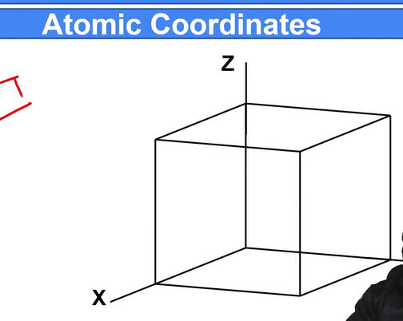

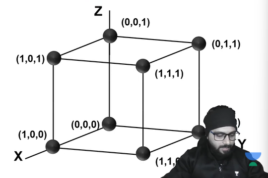

> Atomic coordinates are direction vectors  

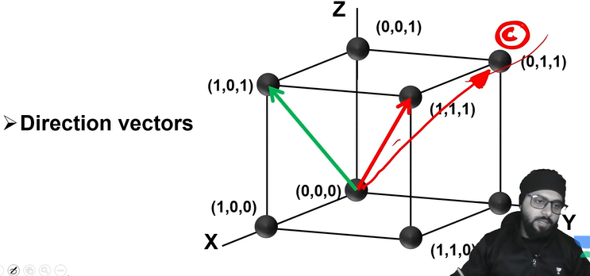

**Question**  

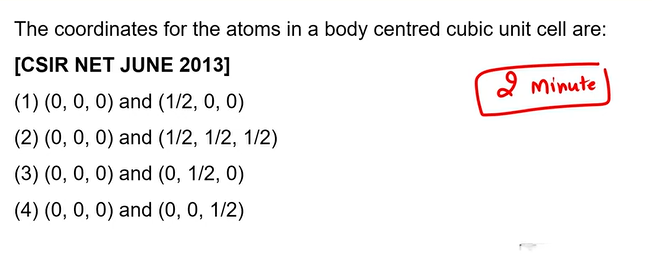

> First determine where are atoms present in body centered  
> Body center and at every corner  

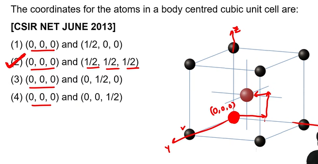

## Lattice Planes

e.g. 

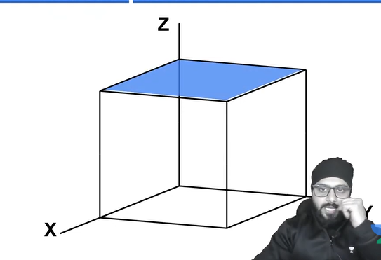

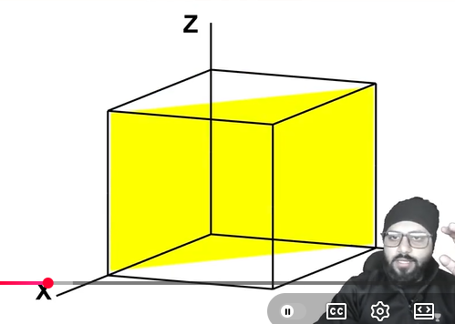

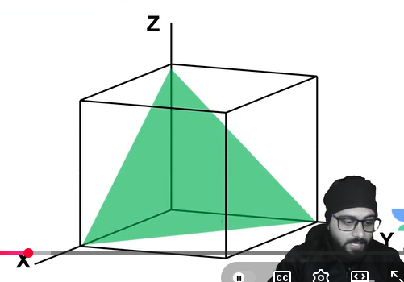

> There can be many planes in a cube

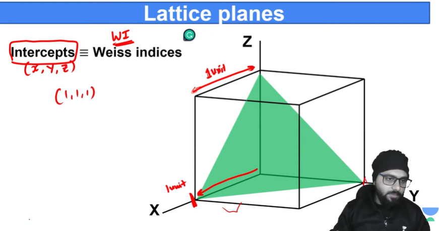

> In above just write down the intercept on X, Y and Z axis. so it will be (1,1,1)  
> And the reciprocal of those Weiss Indices is called Miller indices  

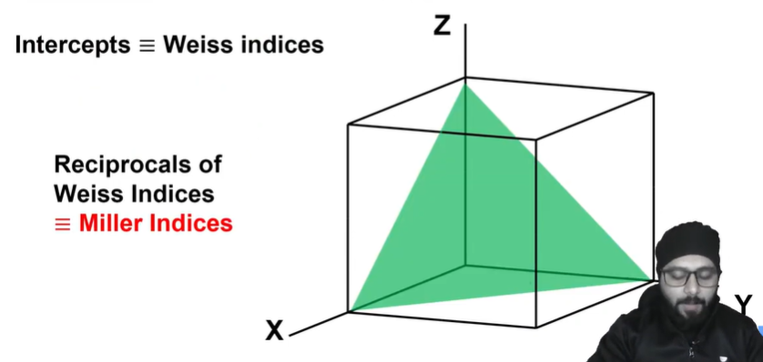

> If we found the Weiss Indices then why do we need reciprocal of those?  

> So if Weiss indices are (a,b,c) then Miller indices are (1/a ; 1/b ; 1/c)

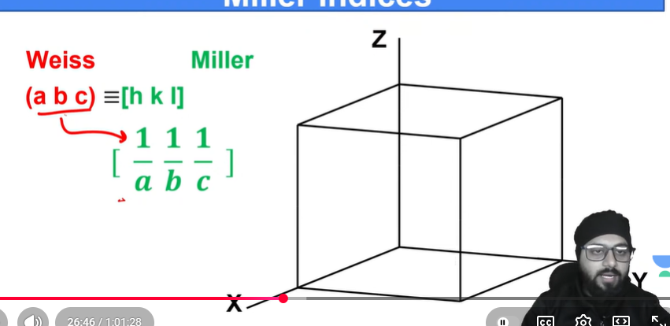

> And convection wise 1/a is called h  
> 1/b is called k  
> 1/c is called l  

> While representing we don't have to use comma in between. And if you put comman then we don't consider that as miller indices  

> Now let's find Miller indices of some planes  

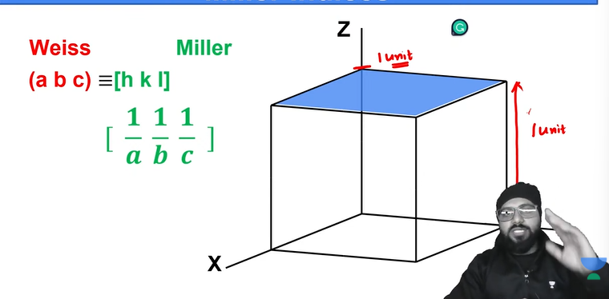

> Z intercept is 1  
> The plane is parallel to x and y so it will cut it at Infinity  
> So X and Y intercept will be Infinity and Infinity  
> so weiss indices will be ( ∞, ∞ , 1 )
> Infinity confuses and we don't like it so we take reciprocal  
> (1/∞ , 1/∞ , 1/1) = (0 0 1)  

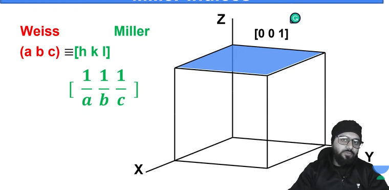

similarly find out miller indices for below

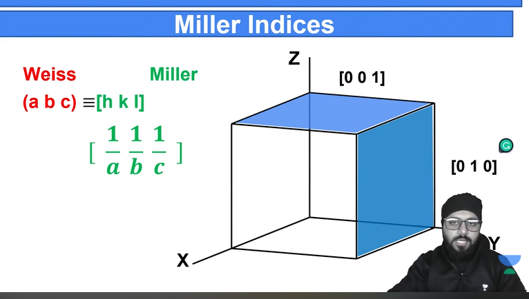

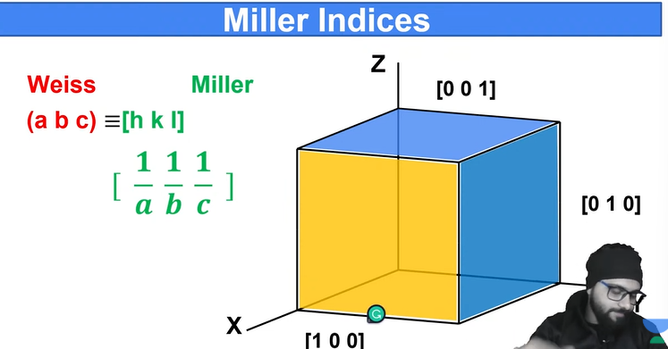

Try below  

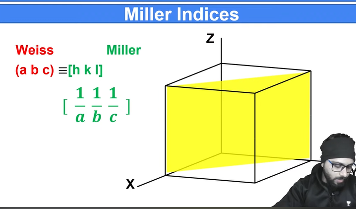

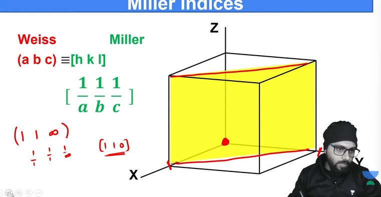

Ans - (1 1 0)

Try below  

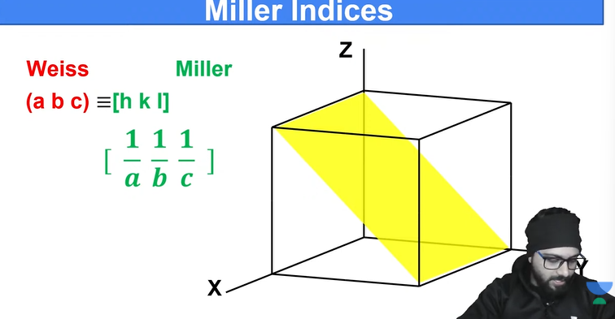

Ans - (0 1 1)  (above plane is parallel to X)

Try below  

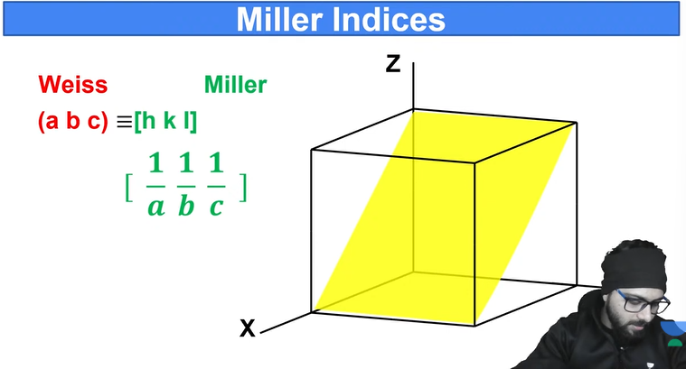

Ans - (1 0 1)  (Plane is parallel to Y)

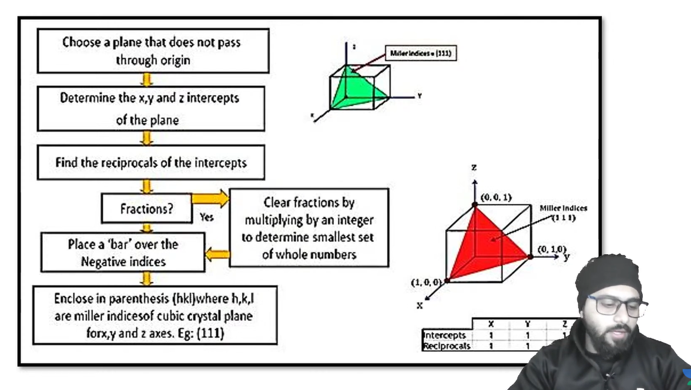

> To find out miller Indices of a plane take an origin where no planes are passing

Question 2  

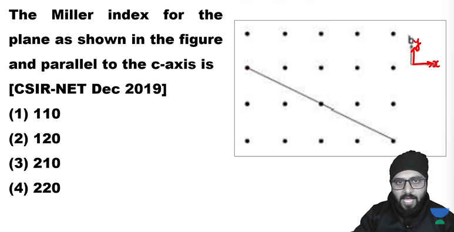

find intercept directly

So Weiss indices are (4,2, ∞)

so take reciprocal now

(1/4 1/2 1/∞ )

mulitply each number by 4  

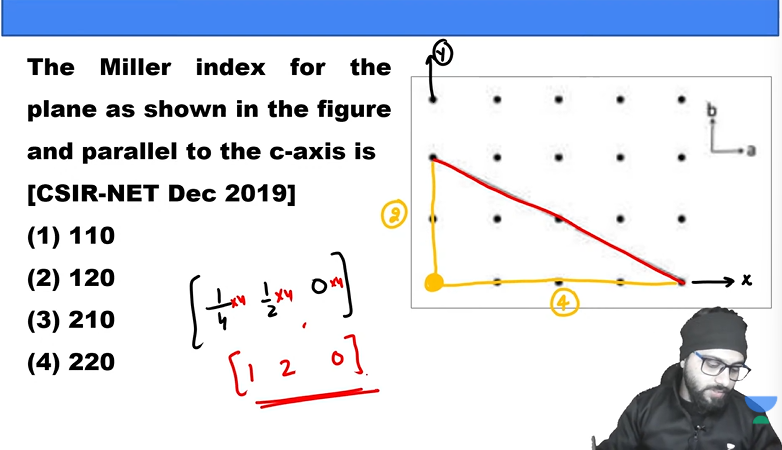

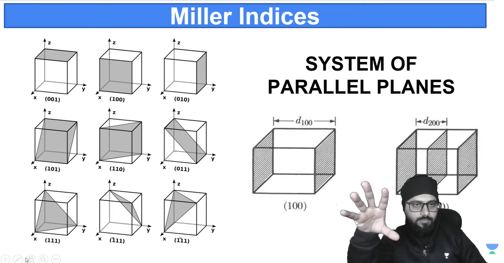

Now whatever h k l or miller indices you found out, that basically **represents set of prallel planes**

some have bar on the number. It basically represents negative number  

## Interplanar Distance

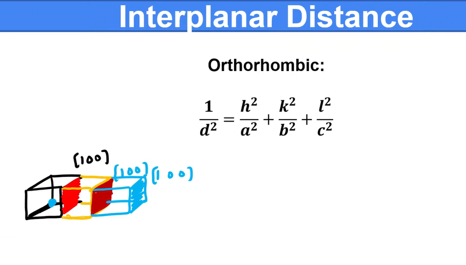

in above diagram [1 0 0] is representing not representing a single plane. it's representing a set of parallel plane.  

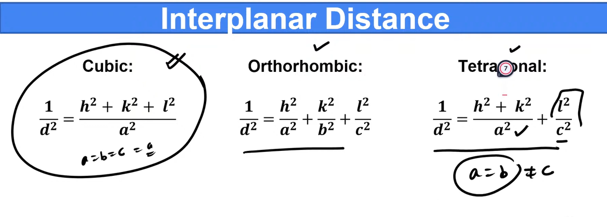

in cubic a, b and c are equal so I have taken LCM

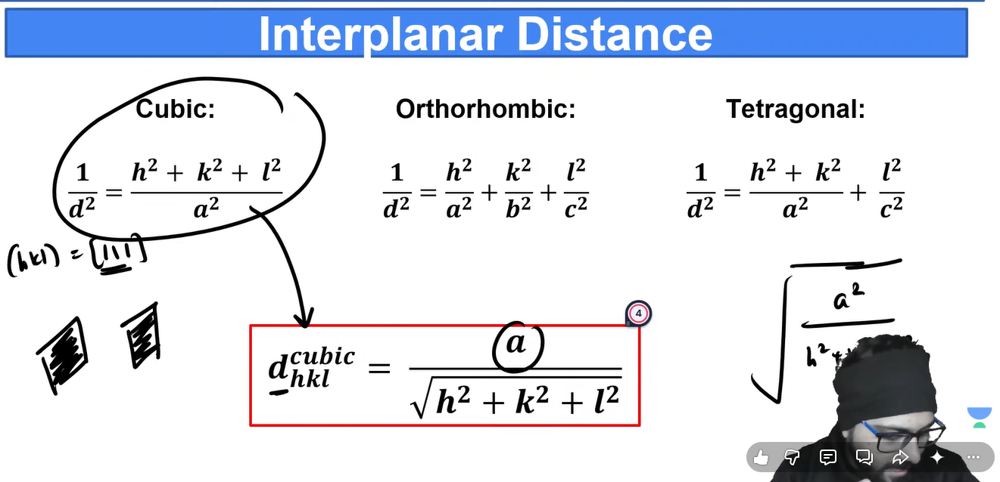

d(hkl) is basically distance between parallel plane

Question 3

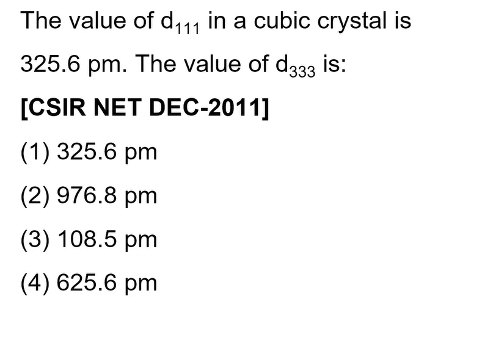

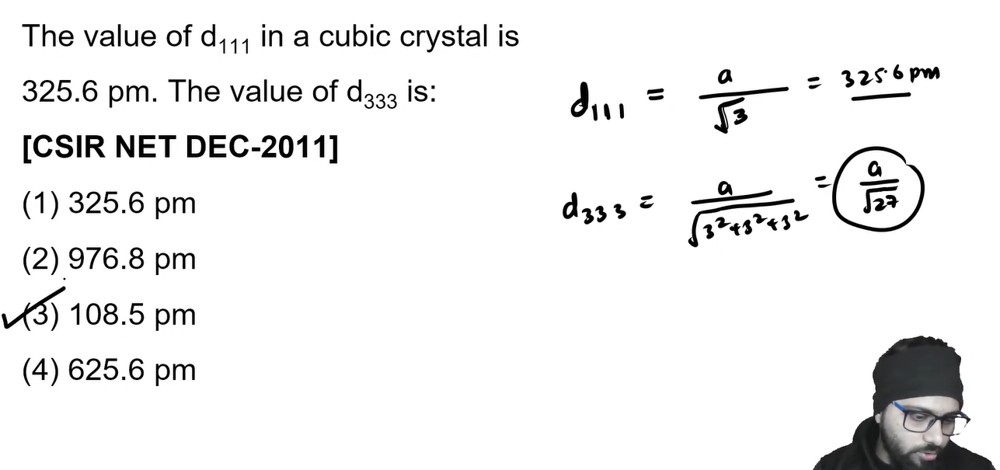

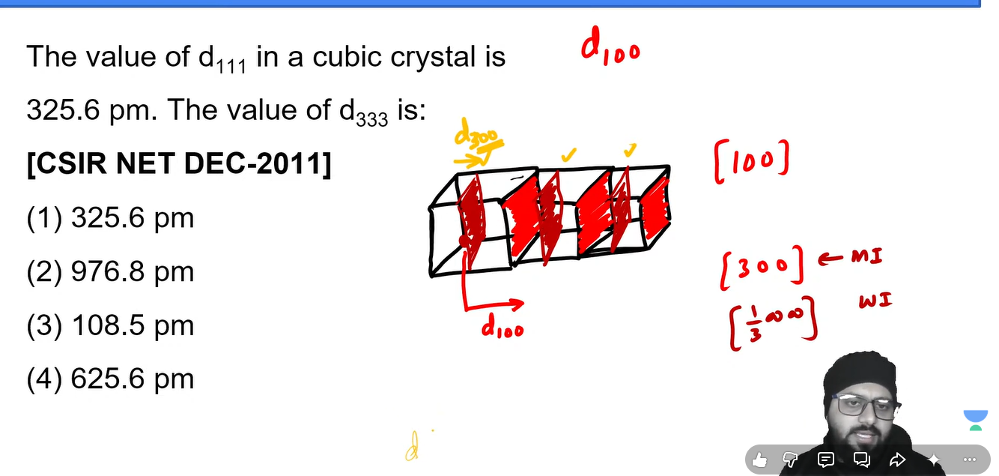

